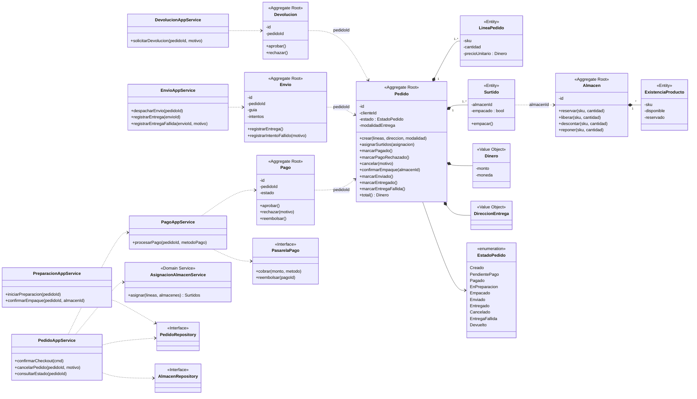
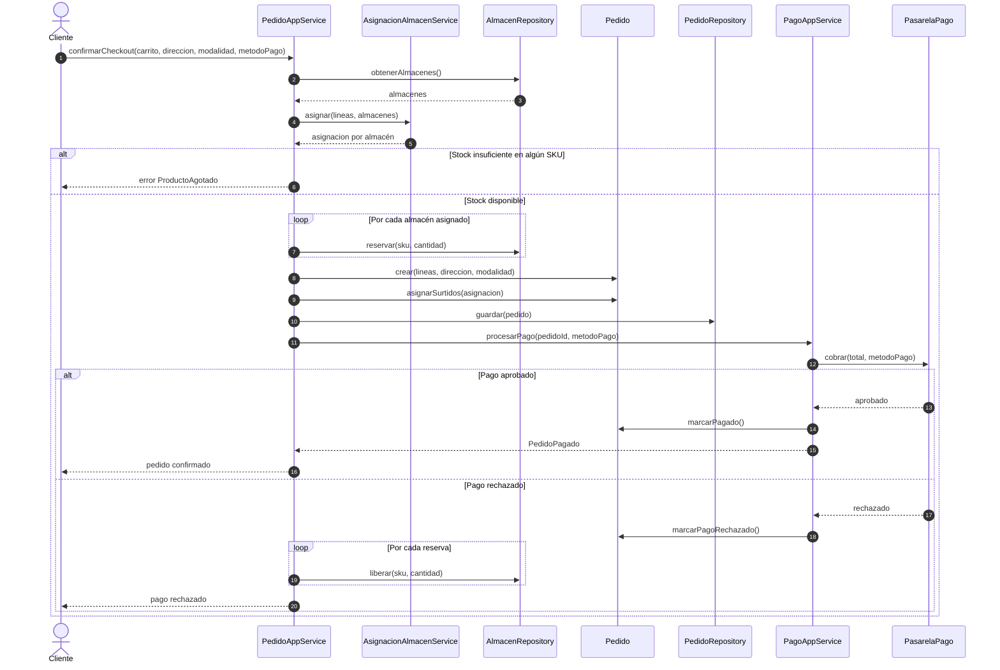
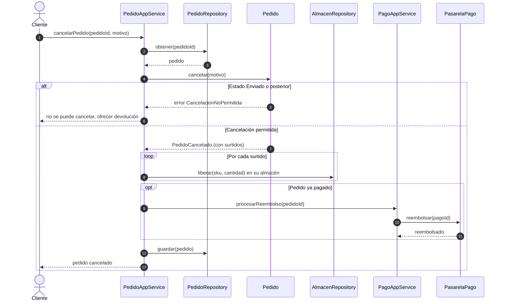

# PetMarket · Persona 3: Service Layer y Diagramas UML

## 1. Supuestos (a validar con la Persona 2 y el stakeholder)

- Aggregate Roots: **Pedido**, **Almacen**, **Pago**, **Envio**, **Devolucion**.
- Un pedido dividido entre almacenes se modela con **Surtido** (una entidad dentro de Pedido por cada almacén).
- Estados del Pedido: `Creado, PendientePago, Pagado, EnPreparacion, Empacado, Enviado, Entregado, Cancelado, EntregaFallida, Devuelto`.
- La asignación de almacenes y los plazos de cancelación/devolución son reglas de negocio por confirmar; aquí solo se marca dónde viven.

## 2. Service Layer (un método por caso de uso)

Regla: los servicios **solo orquestan** (cargar agregado, llamar su método, guardar, publicar eventos). Toda regla vive en el dominio.

| Servicio | Método (caso de uso) | Orquesta | Lógica que NO lleva |
|---|---|---|---|
| PedidoAppService | `confirmarCheckout` | Valida carrito, pide asignación de almacenes, reserva stock, crea Pedido, inicia pago | Qué almacén surte, si hay stock suficiente |
| PedidoAppService | `cancelarPedido` | Carga Pedido, pide cancelar, libera reservas, solicita reembolso | Si todavía se puede cancelar |
| PedidoAppService | `consultarEstado` | Lee Pedido y sus Surtidos/Envíos | Cálculo de estado |
| PagoAppService | `procesarPago` | Llama pasarela, registra resultado en Pago y Pedido | Reglas de aprobación/rechazo |
| PreparacionAppService | `iniciarPreparacion` | Notifica al Surtido del almacén | Validar que el pedido esté pagado |
| PreparacionAppService | `confirmarEmpaque` | Marca Surtido empacado; si todos lo están, avanza Pedido | Regla "todos los surtidos listos" |
| EnvioAppService | `despacharEnvio` | Crea Envio con paquetería | Elegir modalidad |
| EnvioAppService | `registrarEntrega` | Cierra Envio y Pedido | Transición de estado |
| EnvioAppService | `registrarEntregaFallida` | Registra intento fallido | Número máximo de intentos |
| DevolucionAppService | `solicitarDevolucion` | Crea Devolucion, repone stock al aprobarse | Elegibilidad y plazo |

## 3. Diagrama de clases

## 4. Diagrama de secuencia 1: Checkout con pedido dividido y pago

Cubre pedido dividido entre almacenes, producto agotado y pago rechazado.

## 5. Diagrama de secuencia 2: Cancelación antes del envío

Cubre cancelación con reembolso y liberación de stock en ambos almacenes.

> Nota: `procesarReembolso` aparece en la secuencia 2 como operación de PagoAppService; si el profe pide un método por caso de uso estricto, agrégalo a la tabla de la sección 2.
